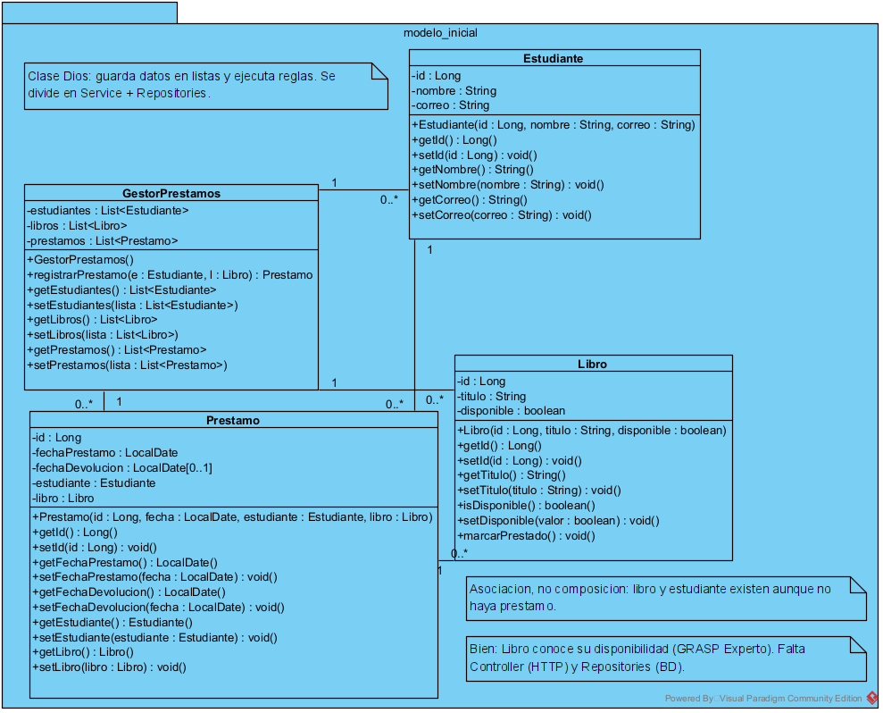
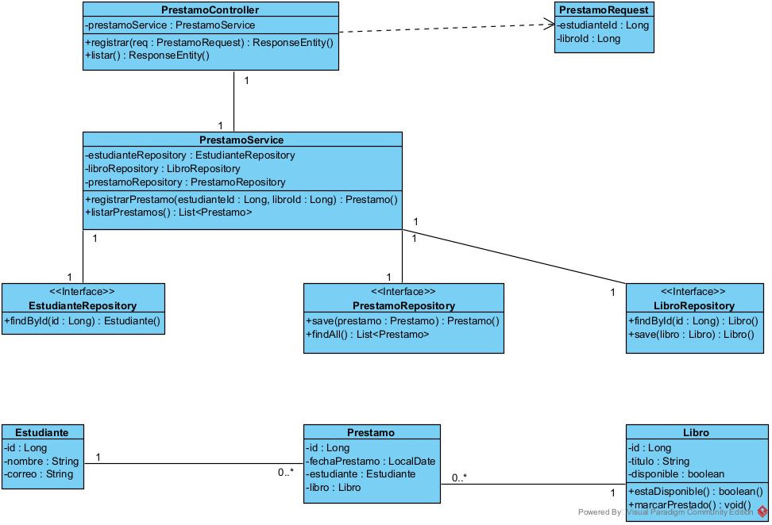
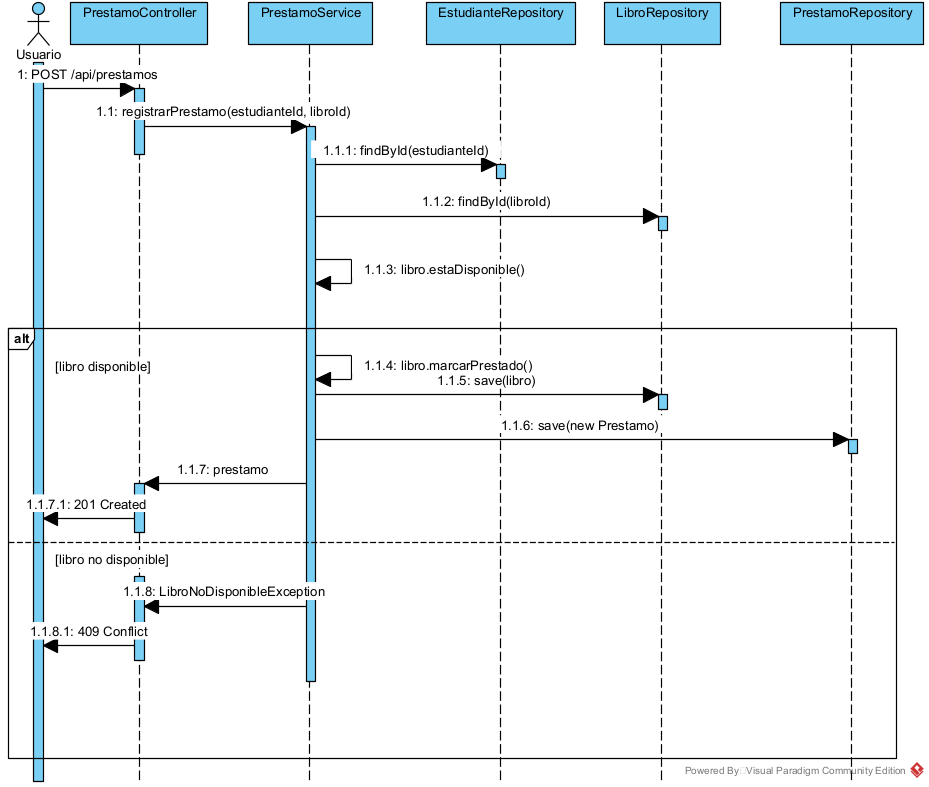

# Taller práctico 7 — SmartLibrary: Registrar préstamo

API REST con Spring Boot (Java 21, Maven, Spring Web, Spring Data JPA, Validation y H2) organizada en tres capas: Controller → Service → Repository. Implementa **exactamente** el diagrama de clases por capas y el diagrama de secuencia del caso de uso «Registrar préstamo».

## Diagramas

| Vista lógica (modelo inicial) | Clases por capas | Secuencia: registrar préstamo |
|---|---|---|
|  |  |  |

## Del diagrama al código

| Diagrama | Paquete / clase |
|---|---|
| PrestamoController | `controller/PrestamoController` |
| PrestamoRequest | `dto/PrestamoRequest` |
| PrestamoService | `service/PrestamoService` |
| «Interface» EstudianteRepository, LibroRepository, PrestamoRepository | `repository/*` (solo declaran las operaciones del diagrama) |
| Estudiante, Libro, Prestamo | `model/*` (`Prestamo` 0..* → 1 `Estudiante` y 0..* → 1 `Libro` con `@ManyToOne`) |
| LibroNoDisponibleException (mensaje 1.1.8 de la secuencia) | `service/LibroNoDisponibleException` |

`SmartLibraryApplication` es solo la clase de arranque que exige Spring Boot.

## Reglas del caso de uso

- **R1**: solo un libro disponible puede prestarse → `Libro.estaDisponible()`, lo verifica `PrestamoService`.
- **R2**: el préstamo registra estudiante, libro y fecha → constructor de `Prestamo`.
- **R3**: al prestarlo, el libro deja de estar disponible → `Libro.marcarPrestado()`.
- **R4**: una solicitud inválida no crea préstamo → `@Transactional` en `registrarPrestamo` y validación `@NotNull` del request.

## Ejecutar

```bash
mvn spring-boot:run
```

Datos de prueba (`data.sql`): estudiantes 1 y 2; libros 1 y 2 disponibles, libro 3 ya prestado.

## Pruebas

| Escenario | Petición | Resultado esperado |
|---|---|---|
| Préstamo de libro disponible | `POST /api/prestamos {"estudianteId":1,"libroId":1}` | 201 Created |
| Libro ya prestado | `POST /api/prestamos {"estudianteId":1,"libroId":3}` | 409 Conflict |
| Estudiante inexistente | `POST /api/prestamos {"estudianteId":99,"libroId":2}` | 404 Not Found |
| Libro inexistente | `POST /api/prestamos {"estudianteId":1,"libroId":99}` | 404 Not Found |
| Consulta de préstamos | `GET /api/prestamos` | 200 OK |

```bash
curl -i -X POST localhost:8080/api/prestamos -H "Content-Type: application/json" -d '{"estudianteId":1,"libroId":1}'
curl -i localhost:8080/api/prestamos
```
